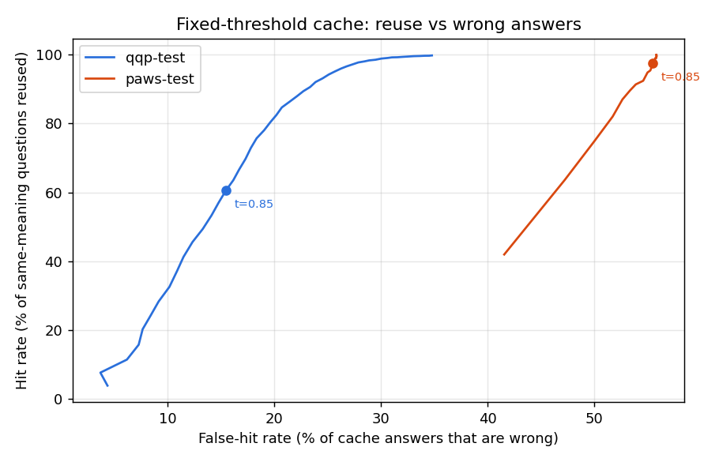

# CacheGuard

**A semantic cache that knows when it's wrong.**

CacheGuard sits in front of an answer backend (today a document search, later an LLM via Groq). When a new question means the same thing as one it has already answered, it returns the saved answer instantly instead of calling the backend again. The goal of the project is to do that *without* serving wrong answers for questions that look alike but are different ("cancel my order" vs "don't cancel my order"), and to measure exactly how often that happens.

> **Status: Phase 2 (cache core).** The project grew out of a 20 Newsgroups semantic search system (preserved at the git tag `v0-newsgroups-search`). Phase 0 restructured it and fixed measured bugs; Phase 1 measured how often a fixed-threshold cache serves wrong answers; Phase 2 made the cache a real store: partitioned, persistent, expiring and invalidatable. See [Roadmap](#roadmap).

## The problem, measured

A plain semantic cache reuses an answer when two questions are "similar enough" (cosine similarity ≥ a fixed threshold, 0.85 in the original project). [Phase 1](benchmarks/results/phase1_baseline/README.md) measured what that costs, on Quora Question Pairs (QQP), PAWS, and 2,000 generated "looks the same, means something different" questions:

| At threshold 0.85 | Result |
|---|---|
| Cache answers that were for a different question (replaying 26,858 queries) | **43.5%** (30.9% on natural queries only) |
| "How do I *not* cancel…" treated as "How do I cancel…" | **99.4%** of negated questions |
| Swapped number ("5 hours" → "10 hours") reused | **90.8%** |
| Swapped antonym ("best" → "worst") reused | **86.2%** |
| PAWS word-order pairs (different meaning) | AUC **0.63**: barely better than chance |

And no single threshold fixes it. Calibrated on held-out data, a 1% wrong-answer budget forces the threshold to 0.998, where the cache reuses **0.7%** of paraphrases: it is safe only because it almost never fires.



This is what the later phases address: per-cluster thresholds and a verifier for borderline matches (Phase 3). Phase 1's numbers are the baseline those changes must beat.

**Caveat:** QQP "not duplicate" labels are incomplete. Some counted wrong hits are true paraphrases (even at similarity ≥ 0.996, 11.5% of natural hits land in a different labeled group, which is mostly label noise). False-hit rates are therefore upper bounds; the hard-negative numbers do not have this problem.

## How a request flows

```
question + namespace
   │
   ├─► partition key (namespace + backend; exact match, never shared)
   ├─► embed (MiniLM)
   ├─► FAISS search in that partition only, skipping expired entries
   ├─► similarity ≥ threshold policy?
   │      yes ─► return cached answer (hit count + recency updated)
   │      no  ─► ask backend ─► store answer, tagged by namespace and source documents
   │                              (SQLite write-through, LRU eviction past the cap)
   └─► response explains itself: similarity, threshold, nearest cached question
```

## Quick start

```bash
pip install -e ".[dev]"
```

Download the [20 Newsgroups dataset](https://archive.ics.uci.edu/dataset/113/twenty+newsgroups) and extract it so the folders are at `data/20_newsgroups/<newsgroup>/`.

Build the search index (embeds ~19k documents; takes a few minutes on CPU):

```bash
python -m cacheguard.build
```

Run the API, then open http://127.0.0.1:8000/docs:

```bash
uvicorn cacheguard.api:create_default_app --factory
```

Or use the terminal client:

```bash
python -m cacheguard.cli
```

Reproduce the Phase 1 benchmark (downloads ~6 MB of QQP/PAWS data from Hugging Face; about 8 minutes on CPU):

```bash
pip install -e ".[bench]"
```

```bash
python -m cacheguard.bench.run
```

Run the tests (no model download needed; they use a small fake embedder):

```bash
pytest
```

## API

| Method | Path | Purpose |
|---|---|---|
| `POST` | `/query` | Answer a query (optional `namespace`), from cache when possible |
| `GET` | `/cache/stats` | Totals and per-partition entries, hits, misses, evictions, expirations, invalidations |
| `DELETE` | `/cache` | Clear the cache |
| `DELETE` | `/cache/entries/{id}` | Remove one cached answer |
| `POST` | `/cache/invalidate` | Remove all answers for `{"tag": "source:1234"}` or `{"namespace": "team-a"}` |
| `GET` | `/health` | Liveness, backend name, entry count |

`POST /query` with `{"query": "why was the shuttle launch delayed"}` (after `"space shuttle launch delays"` was asked) returns:

```json
{
  "query": "why was the shuttle launch delayed",
  "namespace": "default",
  "cache_hit": true,
  "entry_id": 1,
  "matched_query": "space shuttle launch delays",
  "cache_similarity": 0.871,
  "threshold": 0.85,
  "nearest_query": "space shuttle launch delays",
  "dominant_cluster": 0,
  "answer": "…best matching post…",
  "sources": [{"doc_id": 1234, "newsgroup": "sci.space", "score": 0.545, "snippet": "…"}],
  "latency_ms": 22.5
}
```

`cache_similarity` and `nearest_query` describe the nearest cached question in the same namespace, also on a miss, so a near-miss can be explained. `sources[].score` is the cosine similarity between the query and each document.

### Configuration

Environment variables (defaults in [config.py](cacheguard/config.py)):

| Variable | Default | Meaning |
|---|---|---|
| `CACHEGUARD_CACHE_THRESHOLD` | `0.85` | Global similarity threshold (Phase 3 replaces this) |
| `CACHEGUARD_CACHE_DB_PATH` | `artifacts/cache.sqlite3` | SQLite file; `:memory:` disables persistence |
| `CACHEGUARD_CACHE_TTL_SECONDS` | `604800` (7 days) | Default entry lifetime; `none` disables expiry |
| `CACHEGUARD_CACHE_MAX_ENTRIES` | `50000` | LRU eviction cap; `none` disables |
| `CACHEGUARD_FAISS_THREADS` | `1` | Threads per FAISS search (see scale results) |

## Project layout

```
cacheguard/
  config.py          settings (override with CACHEGUARD_* env vars)
  embeddings.py      sentence-transformers wrapper, unit-normalized output
  vector_index.py    FAISS exact inner-product (cosine) index
  store.py           cache store: partitioned FAISS indexes, SQLite, TTL, LRU, tag invalidation
  policy.py          threshold policies (global today; calibrated in Phase 3)
  partitions.py      exact-match partition keys (namespace, backend, model settings)
  cache.py           original list cache, kept as the benchmark baseline
  clustering.py      Gaussian mixture soft clustering, saved as .npz (no pickle)
  backends/          what answers on a cache miss (newsgroups search for now)
  data/newsgroups.py loading, cleaning and de-duplicating the corpus
  artifacts.py       build/save/load the precomputed index, with a manifest
  service.py         the request path: embed, look up, answer, store
  api.py             FastAPI app
  build.py, cli.py   command-line entry points
  bench/             benchmark: datasets, hard negatives, pair metrics, workload replay
benchmarks/results/  committed benchmark reports
tests/               pytest suite
```

## What Phase 0 fixed, and why

These came from measuring the original system rather than reading it:

| Problem found | Evidence | Fix |
|---|---|---|
| **Label leakage.** Cleaning removed only `From:`/`Subject:`, so `Xref`/`Path`/`Newsgroups` headers (which name the newsgroup) stayed in every document and were embedded. They also used up much of MiniLM's 256-token window. | 19,997 of 19,997 cleaned docs still contained the headers. | Drop the whole header block, quoted replies and signatures (`data/newsgroups.py`). |
| **Duplicate documents.** Cross-posted messages appear once per newsgroup. | 663 exact duplicate bodies. | De-duplicate after cleaning. |
| **Misleading score.** On a cache miss, `similarity_score` reported the nearest *cache* similarity, not a retrieval score. | Code review. | Separate `cache_similarity` and per-source `score`, top-k results instead of one. |
| **Unsafe model loading.** The clustering model was a pickle file, which can execute code when loaded. | `joblib.load`. | Store the mixture's arrays in `.npz` and load with `allow_pickle=False`. |
| **Large binaries in git.** ~48 MB of generated files were committed. | `embeddings.npy`, `gmm_model.pkl`. | Untracked; rebuilt by `cacheguard.build` with a manifest that detects stale indexes. |
| **Cache not thread-safe.** FastAPI runs sync endpoints in a thread pool. | Code review. | Lock around cache reads and writes. |
| **Fragile loader.** Bare `except:`, label ids counted stray files, unpinned dependencies, no tests. | Code review. | Specific error handling, sorted folder-based labels, pinned `pyproject.toml`, tests. |

Effect of the leak fix: on the rebuilt index, the share of a document's 10 nearest neighbours from the same newsgroup fell from **0.77 to 0.67**. About 10 points of the original "quality" came from the leaked headers.

**Known issue, deferred to Phase 3:** the Gaussian mixture is "soft" in name only. With full covariance in 384 dimensions, over 99.9% of documents get more than 0.99 probability for a single cluster. It will be reworked when clusters start driving per-cluster cache thresholds.

## Phase 2: cache core

The original cache was a Python list scanned on every request, lost on restart, unbounded, and shared by everyone. [`CacheStore`](cacheguard/store.py) replaces it:

| Concern | Design | Why |
|---|---|---|
| Isolation | One FAISS index per **partition** (namespace + backend; later model, system prompt, temperature). Partition keys match exactly. | A similarity threshold must never be what stops one tenant from receiving another tenant's answer. |
| Lookup | FAISS exact inner-product index with ID mapping (`IndexIDMap2(IndexFlatIP)`). | ID mapping supports deletion, which eviction and invalidation need. |
| Freshness | Per-entry TTL, checked lazily at lookup (the 8 nearest candidates are fetched so an expired nearest entry falls through to the next valid one). | No background sweeper thread; expired entries are removed as they are encountered. |
| Size | LRU eviction past `max_entries`; a hit refreshes recency. | Bounded memory under any traffic. |
| Invalidation | Entries are tagged `namespace:…` and `source:<doc id>`. | When a source document changes, every answer derived from it can be dropped in one call. |
| Durability | SQLite write-through (WAL mode); indexes rebuilt on startup in LRU order. | A restart keeps the cache warm. Hit/miss counters are runtime-only. |
| Memory | Vectors live only in FAISS and SQLite, not on entry objects. | Found while sizing the benchmark: entries were holding a second copy of every vector. |

[Scale benchmark](benchmarks/results/phase2_scale/README.md) (single-query lookup, 384-dim):

| Cached entries (one partition) | Old list scan p50 | CacheStore p50 | Restart from SQLite |
|---|---|---|---|
| 10,000 | 0.55 ms | 0.48 ms | 0.19 s |
| 50,000 | 5.15 ms | 3.76 ms | 1.06 s |
| 200,000 | 22.13 ms | 14.52 ms | 5.00 s |

What the numbers decided:

- **Exact search stays.** Both versions are linear in cache size; FAISS is 1.1–1.5x faster, not a different complexity class. Embedding the question already takes ~10–20 ms and an LLM call hundreds of ms, so exact search is fine up to tens of thousands of entries per partition, which the eviction cap and partitioning keep it under.
- **HNSW was measured and rejected for now.** It was 0.3–0.6 ms at every size, but on these vectors it returned the true nearest neighbour only 66% (10k) to 7% (200k) of the time, takes minutes to build, and cannot delete entries. For a cache, a missed neighbour is a missed hit (wasted money), not a wrong answer, so approximate search is a cost trade-off to revisit only if a partition outgrows exact search.
- **FAISS runs single-threaded per search.** With 12 OpenMP threads, each single-query search paid ~0.5 ms of thread start-up, 10x the search itself at 2k entries. Parallelism comes from concurrent requests instead.

## Roadmap

| Phase | Goal |
|---|---|
| 0 | Foundation: restructure, fix measured bugs, tests *(done)* |
| 1 | Benchmark harness: paraphrase datasets (QQP, PAWS) and hard negatives; measure the baseline cache's hit rate vs wrong-hit rate *(done)* |
| 2 | Cache core: FAISS-backed cache, persistence, expiry and eviction, partitioning by model/tenant *(done)* |
| 3 | Correctness: calibrated and per-cluster thresholds, verifier for borderline matches |
| 4 | Gateway: Groq LLM backend, OpenAI-compatible API, demo chat page |
| 5 | Operations: metrics, dashboard, load tests, Docker, deployment |
| 6 | Write-up: results, design decisions, what didn't work |

## Tech

Python, FastAPI, sentence-transformers (`all-MiniLM-L6-v2`), FAISS, scikit-learn, NumPy, pytest.
