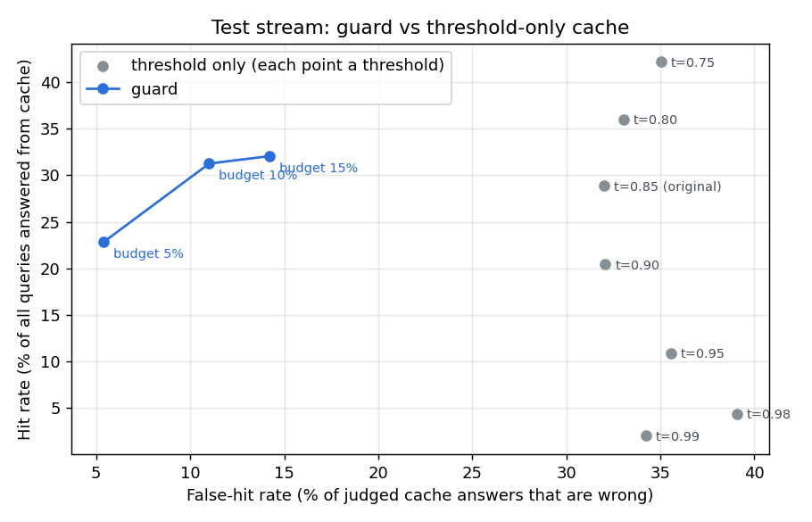

# CacheGuard

**A semantic cache that knows when it's wrong.**

CacheGuard sits in front of an LLM API (Groq). When a new question means the same thing as one it has already answered, it returns the saved answer instantly instead of paying for another AI call. The point of the project is to do that *without* serving wrong answers for questions that look alike but are different ("cancel my order" vs "don't cancel my order"), and to measure exactly how often that happens.

> **Status: Phase 4 (gateway and demo).** The project grew out of a 20 Newsgroups semantic search system (preserved at the git tag `v0-newsgroups-search`). Phase 0 restructured it and fixed measured bugs; Phase 1 measured how often a fixed-threshold cache serves wrong answers; Phase 2 made the cache a real store; Phase 3 added the guard that decides when reuse is safe; Phase 4 put it in front of Groq with an OpenAI-compatible API and a demo chat page. See [Roadmap](#roadmap).

## Result

Replaying the same 26,858-question test stream (Quora questions plus 2,000 generated look-alikes) through both caches:

| | Correct answers from cache | **Wrong answers from cache** | Look-alikes served the wrong answer |
|---|---|---|---|
| Plain semantic cache (threshold 0.85, the original project) | 4,377 | **2,061** | 1,303 of 1,998 |
| **CacheGuard** (calibrated for a 5% error budget) | 4,231 | **241** (−88%) | 74 of 1,998 |
| CacheGuard (calibrated for 10%) | 5,123 (+17%) | 634 (−69%) | 326 of 1,998 |

CacheGuard keeps 97% of the useful reuse while serving 88% fewer wrong answers. The 5% budget was chosen on separate calibration data and held on test (5.4% measured). The cost: the cross-encoder verifier runs on ~60% of lookups at ~31 ms each on CPU. [Full Phase 3 report](benchmarks/results/phase3_guard/README.md).



## The problem, measured

A plain semantic cache reuses an answer when two questions are "similar enough" (cosine similarity ≥ a fixed threshold, 0.85 in the original project). [Phase 1](benchmarks/results/phase1_baseline/README.md) measured what that costs, on Quora Question Pairs (QQP), PAWS, and 2,000 generated "looks the same, means something different" questions:

| At threshold 0.85 | Result |
|---|---|
| Judged cache answers that were for a different question (replaying 26,858 queries) | **32.0%** (14.7% on natural queries only) |
| "How do I *not* cancel…" treated as "How do I cancel…" | **99.4%** of negated questions |
| Swapped number ("5 hours" → "10 hours") reused | **90.8%** |
| Swapped antonym ("best" → "worst") reused | **86.2%** |
| PAWS word-order pairs (different meaning) | AUC **0.63**: barely better than chance |

No single threshold fixes it: on the test stream, every threshold from 0.75 to 0.99 serves 32–39% wrong answers among judged hits, because negations and swapped numbers sit at similarity 0.95–0.98, above paraphrases.

**How errors are counted (a correction).** QQP annotators labeled specific pairs, not all pairs. Phase 1 first counted every hit between questions from different labeled pairs as wrong (43.5% at 0.85). A manual check in Phase 3 showed 64% of such high-similarity "errors" had never been compared by annotators, and most were real paraphrases ("How do I increase my level of confidence?" / "How can I improve my confidence?"). All Phase 3 numbers therefore judge only pairs the labels cover: same labeled group = correct; labeled "not duplicate" or a generated look-alike = wrong; anything else = unjudged and excluded from error rates (70–90% of hits are judged).

## How a request flows

```
question + namespace
   │
   ├─► partition key (namespace + backend; exact match, never shared)
   ├─► embed (MiniLM)
   ├─► FAISS search in that partition only, skipping expired entries
   ├─► guard (outside the store lock, so a slow check never blocks other requests):
   │      similarity < gate                    → miss
   │      negation / number / name swapped     → reject   (rules, ~0.1 ms)
   │      cross-encoder says same question     → hit      (~30 ms, borderline only)
   │      otherwise                            → reject
   │   hit ─► return cached answer (hit count + recency updated)
   │   no  ─► ask backend ─► store answer, tagged by namespace and source documents
   │                          (SQLite write-through, LRU eviction past the cap)
   └─► response explains itself: similarity, nearest cached question, which stage decided and why
```

## Quick start

```bash
pip install -e ".[dev]"
```

Copy `.env.example` to `.env` and set `GROQ_API_KEY` (from the [Groq console](https://console.groq.com/keys)). `.env` is git-ignored.

Run the server, then open the demo at http://127.0.0.1:8000/ (API docs at `/docs`). The first start downloads the embedding model and the cross-encoder (~420 MB):

```bash
uvicorn cacheguard.api:create_default_app --factory
```

### Without a Groq key

CacheGuard falls back to the original 20 Newsgroups search as its backend. Download the [20 Newsgroups dataset](https://archive.ics.uci.edu/dataset/113/twenty+newsgroups), extract it so the folders are at `data/20_newsgroups/<newsgroup>/`, and build the search index (embeds ~19k documents; ~12 minutes on CPU):

```bash
python -m cacheguard.build
```

Or use the terminal client:

```bash
python -m cacheguard.cli
```

Reproduce the Phase 1 benchmark (downloads ~6 MB of QQP/PAWS data from Hugging Face; about 8 minutes on CPU):

```bash
pip install -e ".[bench]"
```

```bash
python -m cacheguard.bench.run
```

Re-calibrate the guard and reproduce Phase 3 (downloads the ~330 MB cross-encoder; ~30 minutes on CPU the first time, cross-encoder scores are then cached). It writes the report and the shipped settings in `configs/guard/`:

```bash
python -m cacheguard.bench.guard_eval
```

The API loads the guard from `configs/guard/` (first start downloads the cross-encoder). Set `CACHEGUARD_GUARD=off` to fall back to the plain threshold.

Run the tests (no model download needed; they use a small fake embedder):

```bash
pytest
```

## API

| Method | Path | Purpose |
|---|---|---|
| `GET` | `/` | Demo chat page |
| `POST` | `/v1/chat/completions` | OpenAI-compatible drop-in (non-streaming); the reply adds a `cacheguard` field |
| `POST` | `/query` | Ask a question (optional `namespace`, `cache`, `guard`); explains every decision |
| `POST` | `/explain` | Dry run: what a plain threshold and the guard would decide now. No AI call, nothing stored |
| `GET` | `/stats` | Hits, decisions by reason, tokens and dollars saved, daily budget left |
| `GET` | `/cache/stats` | Per-partition store counters |
| `DELETE` | `/cache` | Clear the cache (admin) |
| `DELETE` | `/cache/entries/{id}` | Remove one cached answer (admin) |
| `POST` | `/cache/invalidate` | Remove all answers for `{"tag": "model:…"}` or `{"namespace": "team-a"}` (admin, except a visitor's own `demo-…` namespace) |
| `GET` | `/health` | Liveness, backend name, entry count, active guard settings |

Any OpenAI client can point at CacheGuard by changing its base URL:

```python
from openai import OpenAI

client = OpenAI(base_url="http://127.0.0.1:8000/v1", api_key="unused")
reply = client.chat.completions.create(
    model="openai/gpt-oss-20b",
    messages=[{"role": "user", "content": "How do I make my laptop battery last longer?"}],
)
print(reply.choices[0].message.content)
```

`POST /query` with `{"query": "Is five hours of sleep sufficient?"}` (after `"Is 5 hours of sleep enough?"` was asked) returns:

```json
{
  "query": "Is five hours of sleep sufficient?",
  "namespace": "default",
  "cache_hit": true,
  "entry_id": 7,
  "matched_query": "Is 5 hours of sleep enough?",
  "cache_similarity": 0.967,
  "threshold": 0.5,
  "nearest_query": "Is 5 hours of sleep enough?",
  "decision": {"stage": "verifier", "reason": "verified", "verifier_score": 0.978, "decision_ms": 25.2},
  "dominant_cluster": 2,
  "answer": "…",
  "sources": [...],
  "latency_ms": 41.0
}
```

From the live API, other questions asked against those cached:

| Question | Nearest cached question | Similarity | Decision |
|---|---|---|---|
| How do I not cancel my order? | How do I cancel my order? | 0.98 | rejected: `rules / negation` (0.04 ms) |
| Is 8 hours of sleep enough? | Is 5 hours of sleep enough? | 0.87 | rejected: `rules / number` |
| What is the worst way to learn Python? | What is the best way to learn Python? | 0.87 | rejected: `verifier`, score 0.003 |
| How can I cancel an order I placed? | How do I cancel my order? | 0.93 | rejected: `verifier`, score 0.82 < 0.9 (a missed hit: the 5% budget is strict) |

`cache_similarity` and `nearest_query` describe the nearest cached question in the same namespace, also on a miss, so every decision can be explained. `/cache/stats` counts decisions by reason.

### Configuration

Environment variables (defaults in [config.py](cacheguard/config.py)):

| Variable | Default | Meaning |
|---|---|---|
| `GROQ_API_KEY` | (none) | Groq key; with it the backend is Groq, without it the newsgroups search |
| `CACHEGUARD_BACKEND` | `auto` | `auto`, `groq` or `newsgroups` |
| `CACHEGUARD_GROQ_MODEL` | `openai/gpt-oss-20b` | Any Groq chat model id |
| `CACHEGUARD_SYSTEM_PROMPT` | concise assistant | Part of the cache key: changing it starts a fresh partition |
| `CACHEGUARD_TEMPERATURE` | `0` | Cached answers assume deterministic generation; requests asking for another temperature bypass the cache |
| `CACHEGUARD_PRICE_INPUT_PER_M` / `_OUTPUT_PER_M` | `0.075` / `0.30` | USD per 1M tokens, for the "saved" numbers |
| `CACHEGUARD_RATE_LIMIT_PER_MINUTE` | `30` | Per client IP on `/query`, `/explain`, `/v1/chat/completions` |
| `CACHEGUARD_DAILY_BACKEND_CALLS` | `500` | AI calls per UTC day; cache hits keep working after it is spent |
| `CACHEGUARD_PROXY_HOPS` | `0` | Number of hosting proxies in front; the client IP is that many entries from the right of `X-Forwarded-For` (never the forgeable left side) |
| `CACHEGUARD_ADMIN_TOKEN` | (none) | If set, cache admin endpoints need header `X-Admin-Token` |
| `CACHEGUARD_GUARD` | `on` | `off` uses the plain threshold below instead of the guard |
| `CACHEGUARD_GUARD_DIR` | `configs/guard` | Calibrated guard settings |
| `CACHEGUARD_VERIFIER_MODEL` | `cross-encoder/quora-distilroberta-base` | Used if the guard config does not name one |
| `CACHEGUARD_CACHE_THRESHOLD` | `0.85` | Plain threshold, used only when the guard is off |
| `CACHEGUARD_CACHE_DB_PATH` | `artifacts/cache.sqlite3` | SQLite file; `:memory:` disables persistence |
| `CACHEGUARD_CACHE_TTL_SECONDS` | `604800` (7 days) | Default entry lifetime; `none` disables expiry |
| `CACHEGUARD_CACHE_MAX_ENTRIES` | `50000` | LRU eviction cap; `none` disables |
| `CACHEGUARD_FAISS_THREADS` | `1` | Threads per FAISS search (see scale results) |
| `CACHEGUARD_TORCH_THREADS` | `1` | Threads per model inference (see load test); `none` for PyTorch's default |
| `CACHEGUARD_VERIFIER_MEMO_SIZE` | `50000` | Remembered verifier scores; `0` disables (load tests) |
| `CACHEGUARD_BACKEND=mock` + `CACHEGUARD_MOCK_DELAY_MS` | `600` | Fake LLM for load tests: no API cost |

## Project layout

```
cacheguard/
  config.py          settings (override with CACHEGUARD_* env vars)
  embeddings.py      sentence-transformers wrapper, unit-normalized output
  vector_index.py    FAISS exact inner-product (cosine) index
  guard.py           hit decision: gate, rules, verifier; per-cluster settings; save/load
  verify.py          rule checks (negation, numbers, names) and the cross-encoder verifier
  store.py           cache store: partitioned FAISS indexes, SQLite, TTL, LRU, tag invalidation
  policy.py          plain threshold policy (used when the guard is off)
  partitions.py      exact-match partition keys (namespace, backend, model settings)
  cache.py           original list cache, kept as the benchmark baseline
  clustering.py      Gaussian mixture soft clustering, saved as .npz (no pickle)
  backends/          what answers on a cache miss: groq.py (LLM), newsgroups.py (search)
  limits.py          per-client rate limit and daily AI-call budget
  static/demo.html   the demo page (no build step, no external assets)
  data/newsgroups.py loading, cleaning and de-duplicating the corpus
  artifacts.py       build/save/load the precomputed index, with a manifest
  service.py         the request path: embed, look up, answer, store
  api.py             FastAPI app
  build.py, cli.py   command-line entry points
  bench/             benchmarks: datasets, hard negatives, replay, scale, guard calibration
configs/guard/       shipped guard settings (output of bench.guard_eval)
benchmarks/results/  committed benchmark reports
tests/               pytest suite
```

## What Phase 0 fixed, and why

These came from measuring the original system rather than reading it:

| Problem found | Evidence | Fix |
|---|---|---|
| **Label leakage.** Cleaning removed only `From:`/`Subject:`, so `Xref`/`Path`/`Newsgroups` headers (which name the newsgroup) stayed in every document and were embedded. They also used up much of MiniLM's 256-token window. | 19,997 of 19,997 cleaned docs still contained the headers. | Drop the whole header block, quoted replies and signatures (`data/newsgroups.py`). |
| **Duplicate documents.** Cross-posted messages appear once per newsgroup. | 663 exact duplicate bodies. | De-duplicate after cleaning. |
| **Misleading score.** On a cache miss, `similarity_score` reported the nearest *cache* similarity, not a retrieval score. | Code review. | Separate `cache_similarity` and per-source `score`, top-k results instead of one. |
| **Unsafe model loading.** The clustering model was a pickle file, which can execute code when loaded. | `joblib.load`. | Store the mixture's arrays in `.npz` and load with `allow_pickle=False`. |
| **Large binaries in git.** ~48 MB of generated files were committed. | `embeddings.npy`, `gmm_model.pkl`. | Untracked; rebuilt by `cacheguard.build` with a manifest that detects stale indexes. |
| **Cache not thread-safe.** FastAPI runs sync endpoints in a thread pool. | Code review. | Lock around cache reads and writes. |
| **Fragile loader.** Bare `except:`, label ids counted stray files, unpinned dependencies, no tests. | Code review. | Specific error handling, sorted folder-based labels, pinned `pyproject.toml`, tests. |

Effect of the leak fix: on the rebuilt index, the share of a document's 10 nearest neighbours from the same newsgroup fell from **0.77 to 0.67**. About 10 points of the original "quality" came from the leaked headers.

**Known issue:** the Gaussian mixture is "soft" in name only. With full covariance in 384 dimensions, over 99.9% of documents get more than 0.99 probability for a single cluster. Phase 3 did not reuse it: per-cluster guard settings use k-means on *question* embeddings instead, and did not help anyway (see below). It now only labels newsgroup topics.

## Phase 2: cache core

The original cache was a Python list scanned on every request, lost on restart, unbounded, and shared by everyone. [`CacheStore`](cacheguard/store.py) replaces it:

| Concern | Design | Why |
|---|---|---|
| Isolation | One FAISS index per **partition** (namespace + backend; later model, system prompt, temperature). Partition keys match exactly. | A similarity threshold must never be what stops one tenant from receiving another tenant's answer. |
| Lookup | FAISS exact inner-product index with ID mapping (`IndexIDMap2(IndexFlatIP)`). | ID mapping supports deletion, which eviction and invalidation need. |
| Freshness | Per-entry TTL, checked lazily at lookup (the 8 nearest candidates are fetched so an expired nearest entry falls through to the next valid one). | No background sweeper thread; expired entries are removed as they are encountered. |
| Size | LRU eviction past `max_entries`; a hit refreshes recency. | Bounded memory under any traffic. |
| Invalidation | Entries are tagged `namespace:…` and `source:<doc id>`. | When a source document changes, every answer derived from it can be dropped in one call. |
| Durability | SQLite write-through (WAL mode); indexes rebuilt on startup in LRU order. | A restart keeps the cache warm. Hit/miss counters are runtime-only. |
| Memory | Vectors live only in FAISS and SQLite, not on entry objects. | Found while sizing the benchmark: entries were holding a second copy of every vector. |

[Scale benchmark](benchmarks/results/phase2_scale/README.md) (single-query lookup, 384-dim):

| Cached entries (one partition) | Old list scan p50 | CacheStore p50 | Restart from SQLite |
|---|---|---|---|
| 10,000 | 0.55 ms | 0.48 ms | 0.19 s |
| 50,000 | 5.15 ms | 3.76 ms | 1.06 s |
| 200,000 | 22.13 ms | 14.52 ms | 5.00 s |

What the numbers decided:

- **Exact search stays.** Both versions are linear in cache size; FAISS is 1.1–1.5x faster, not a different complexity class. Embedding the question already takes ~10–20 ms and an LLM call hundreds of ms, so exact search is fine up to tens of thousands of entries per partition, which the eviction cap and partitioning keep it under.
- **HNSW was measured and rejected for now.** It was 0.3–0.6 ms at every size, but on these vectors it returned the true nearest neighbour only 66% (10k) to 7% (200k) of the time, takes minutes to build, and cannot delete entries. For a cache, a missed neighbour is a missed hit (wasted money), not a wrong answer, so approximate search is a cost trade-off to revisit only if a partition outgrows exact search.
- **FAISS runs single-threaded per search.** With 12 OpenMP threads, each single-query search paid ~0.5 ms of thread start-up, 10x the search itself at 2k entries. Parallelism comes from concurrent requests instead.

## Phase 3: the guard

The guard ([guard.py](cacheguard/guard.py)) checks a candidate match in stages, cheapest first:

1. **Gate.** Below a similarity floor, it is a miss without further work.
2. **Rules** ([verify.py](cacheguard/verify.py), ~0.1 ms). Reject if negation differs, or if each side has a number or capitalized name the other lacks (a swap). The first version rejected on *any* difference and threw away 37% of real paraphrases ("best laptop?" vs "best laptop under 40k?"); requiring a swap cut that to 10%.
3. **Cross-encoder** (`cross-encoder/quora-distilroberta-base`, ~31 ms on CPU). Reads both questions together instead of comparing two separate embeddings. On QQP calibration pairs: AUC **0.961** vs 0.867 for embedding similarity.

The gate, verifier cut-off and whether rules run are not hand-picked. A grid of 348 settings is scored on a calibration stream, and for each error budget the setting with the most hits within budget is shipped ([guard_eval.py](cacheguard/bench/guard_eval.py)). Calibration and test use disjoint question groups.

What the experiments showed:

- **The cross-encoder does most of the work.** Without rules it reaches 23.2% hits at 6.6% judged errors (5% budget). Rules mainly cut look-alikes served wrong (178 → 74), which is partly circular because the look-alike generator edits the same things the rules check. At 10% and 15% budgets calibration switched rules off.
- **Per-cluster settings did not help.** Settings tuned per question cluster (k-means, 8 clusters) were within ±1.5 points of the global setting on test, better at one budget and worse at another. That is calibration noise, not signal, so the shipped guard uses one global setting.
- **Rules alone are not enough.** Rules plus the best threshold, without the cross-encoder, reached only 10.3% hits at a 15% budget.
- **Open limitations.** The verifier is trained on QQP (train split; tests use validation), so these numbers are in-domain. On PAWS word-order swaps it is worse than embeddings (AUC 0.57 vs 0.63). It runs on ~60% of lookups, adding ~31 ms each; a smaller or quantized verifier, or a calibrated `skip_verify_above`, would cut that.

## Phase 4: gateway and demo

**Groq backend** ([groq.py](cacheguard/backends/groq.py)). Plain `httpx` against Groq's OpenAI-compatible endpoint: retries with backoff on 429/5xx and timeouts (honoring `Retry-After`, capped at 5 s), no retries on client errors such as a bad key, and token usage and cost kept with each cached answer, so a later hit knows exactly what it saved.

**What makes two requests share an answer.** Only the *last user question* is matched by meaning. Everything else is matched exactly and becomes part of the partition key: namespace, backend, model, system prompt, temperature, max tokens, and a hash of the earlier conversation turns. So "how do I install it?" after a Python conversation never gets the answer from a Docker conversation. Requests with a different temperature bypass the cache.

**Public demo protection.** Per-IP rate limit; a daily AI-call budget that cache hits don't consume (when it runs out, cached answers still work and new questions get a clear message); failed AI calls refund the budget; admin token for cache administration; visitors can only reset their own `demo-…` namespace.

**The demo page** (`GET /`). A chat with a live "Why?" panel. For every answer it shows whether it came from cache, the closest cached question, similarity against the gate, and which check passed or failed (gate, rules, verifier with its score). Before each question it calls `/explain`, so it can also show what a plain similarity cache would have done. For example, "Is 8 hours of sleep enough?" after "Is 5 hours…": *"Without the guard, a plain similarity cache (threshold 0.85) would have answered with the cached reply to 'Is 5 hours of sleep enough for an adult?'. That would have been the wrong answer."* Suggested questions walk through a paraphrase hit, a different device, a negation and a swapped number. Each visitor gets a private namespace. The page works at phone width and includes a dark theme. Model answers are rendered from Markdown by a small renderer that only creates text nodes, so model output cannot inject markup.

**Live run against Groq** (`openai/gpt-oss-20b`, Nov 2026, fresh cache):

| Question (in order) | Result | Detail |
|---|---|---|
| How do I make my laptop battery last longer? | AI call | 432 tokens, 595 ms |
| How can I extend my laptop's battery life? | **cache hit** | verifier 0.975; **10 ms** instead of ~600 ms |
| How do I make my phone battery last longer? | refused, AI call | verifier 0.002. A plain 0.85-threshold cache would have served the laptop answer |
| Why doesn't my laptop battery last long? | refused, AI call | negation rule |
| Is 5 hours of sleep enough for an adult? | AI call | below gate vs everything cached |
| Is 8 hours of sleep enough for an adult? | refused, AI call | number rule. A plain cache would have served the 5-hour answer |
| Is five hours of sleep sufficient for adults? | **cache hit** | verifier 0.988; "five" = "5" |
| `/v1/chat/completions`: "What is the capital of Australia?" then "Which city is Australia's capital?" | AI call, then **cache hit** | second reply: 0 tokens used |

## Phase 5: operations

- **Metrics** (`GET /metrics`, Prometheus text format, [metrics.py](cacheguard/metrics.py), no client library):
  - lookups by outcome, deciding stage and reason;
  - latency histograms for whole requests, decisions (including the verifier) and AI calls;
  - backend errors, and requests refused by the rate limit or the daily budget;
  - gauges for cached entries, tokens and dollars saved, and budget left.
- **Request logs.** One JSON line per question: outcome, stage, reason, similarity, verifier score and latencies. The question text is never logged, only a 12-character hash.
- **Startup warm-up.** Both models run once at startup, because a cold verifier call measured 400 ms against ~30 ms warm.
- **Docker image** ([Dockerfile](Dockerfile)):
  - CPU-only PyTorch;
  - dependencies installed in their own layer, so code changes rebuild fast;
  - both models baked in and the Hub switched to offline mode at runtime;
  - runs as a non-root user, with a health check;
  - cache stored on `/data`, and the port taken from `$PORT`.
- **CI** ([ci.yml](.github/workflows/ci.yml)): runs the tests on CPU-only PyTorch (no model downloads, no API key), then builds the image, starts it with the mock backend, and checks the demo page, a query and `/metrics`.
- **Deployment guide:** [docs/DEPLOY.md](docs/DEPLOY.md) (memory needs, environment, hosting options).
- **Image verified locally.**
  - The image is 2.76 GB, ready in 16 s, and reports healthy.
  - Against real Groq inside the container: a paraphrase hit in 84 ms, and a Japan → Korea swap refused by the name rule.
  - The cache survived `docker restart` on the `/data` volume, and no log line contained the key.
  - The first clean build caught two bugs a local setup hid:
    - Unpinned `transformers`/`huggingface_hub` resolved to newer releases that fail to import with PyTorch 2.5.1. The model stack is now pinned to the tested versions.
    - `docker --env-file` passed the quotes around `GROQ_API_KEY` through literally, so Groq rejected the key. Secrets are now stripped of surrounding quotes.

**Load test** ([report](benchmarks/results/phase5_load/README.md)). The test used real Quora paraphrase groups and a mock LLM with 600 ms latency, so it costs nothing and isn't limited by Groq's rate limits. The verifier memo was off.

| Concurrent users | Throughput | Cache-hit p50 | Verifier p50 |
|---|---|---|---|
| 1 | 2.1 req/s | 75 ms | 53 ms |
| 16 | 29.2 req/s | 120 ms | 81 ms |
| 32 | 37.7 req/s | 503 ms | 231 ms |

Findings:

- **The bottleneck is CPU inference.** With PyTorch's default of all 12 threads per call, throughput flattened at ~26 req/s, and at 32 users a cache *hit* took 869 ms, longer than the AI call it replaces. One thread per inference (now the default) gave +42% throughput and halved hit latency, because requests already run in parallel. This is the same lesson as FAISS in Phase 2.
- **Cache stampede.** When paraphrases arrive while the first copy is still waiting on the AI, they all miss: AI calls rose from 273 to 288 between 1 and 32 users. Request coalescing would fix this; it is not implemented.
- **What's next:** at 32 users the server is still CPU-bound. The next steps would be micro-batching verifier calls across requests, or moving the models to an inference service.

## Roadmap

| Phase | Goal |
|---|---|
| 0 | Foundation: restructure, fix measured bugs, tests *(done)* |
| 1 | Benchmark harness: paraphrase datasets (QQP, PAWS) and hard negatives; measure the baseline cache's hit rate vs wrong-hit rate *(done)* |
| 2 | Cache core: FAISS-backed cache, persistence, expiry and eviction, partitioning by model/tenant *(done)* |
| 3 | Correctness: calibrated guard with rules and a cross-encoder verifier; per-cluster settings tested *(done)* |
| 4 | Gateway: Groq LLM backend, OpenAI-compatible API, demo chat page, demo protection *(done)* |
| 5 | Operations: metrics, logs, load test, Docker, CI, deployment guide *(done; public deployment pending a host choice)* |
| 6 | Write-up: results, design decisions, what didn't work |

## Tech

Python, FastAPI, Groq (OpenAI-compatible API via httpx), sentence-transformers (`all-MiniLM-L6-v2` embeddings, `quora-distilroberta-base` cross-encoder), FAISS, SQLite, scikit-learn, NumPy, pytest.
