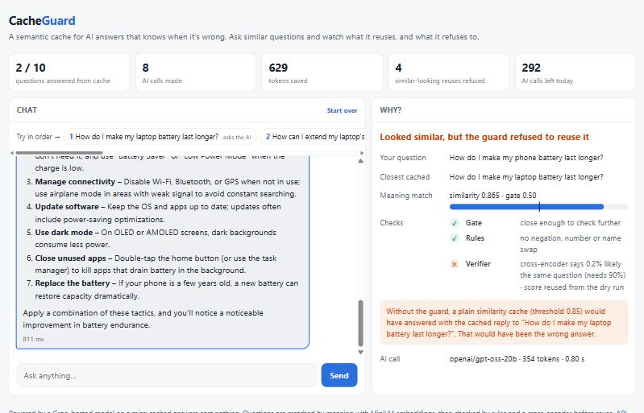
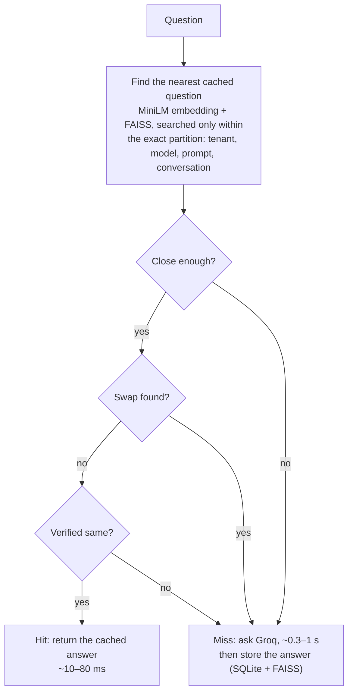

# CacheGuard

[](https://github.com/sujan7710/semantic-search-system/actions/workflows/ci.yml)

**A semantic cache for LLM APIs that knows when it's wrong.**

CacheGuard sits between an app and an LLM API (Groq). When a new question means the same thing as one it has already
answered, it returns the saved answer in milliseconds instead of paying for another AI call. The hard part, and the
point of the project, is **not** reusing an answer when two questions only *look* alike:
"How do I cancel my order?" vs "How do I **not** cancel my order?", "Is **5** hours of sleep enough?" vs "Is **8**
hours…?". A plain semantic cache gets those wrong most of the time. CacheGuard measures how often, and fixes it.

## Result

Replaying the same 26,858-question test stream (real Quora questions plus 2,000 generated look-alikes) through both:

| | Correct answers from cache | Wrong answers from cache | Look-alikes served the wrong answer |
|---|---|---|---|
| Plain semantic cache (similarity ≥ 0.85) | 4,377 | **2,061** | 1,303 of 1,998 |
| **CacheGuard** (calibrated for a 5% error budget) | 4,231 | **241 (−88%)** | **74 of 1,998** |

**88% fewer wrong answers while keeping 97% of the useful reuse.** The error budget was chosen on separate calibration
data and held on the test data (5.4% measured). With the plain cache, every threshold from 0.75 to 0.99 serves
32–39% wrong answers: a typical negated question scores 0.98 similarity to the original, while only 20% of real paraphrases even reach 0.95.


## See it



The demo page answers with a real LLM and explains every decision: the closest cached question, the similarity, which
check passed or failed, and what a plain cache would have done instead. Above, "How do I make my **phone** battery last
longer?" is refused even though it is 0.865 similar to the cached **laptop** question.

## How it works



- **Only the last question is matched by meaning.** Tenant, model, system prompt, temperature and earlier conversation
  turns are part of an exact partition key, so similarity never decides whether one user gets another user's answer.
- **Cheapest check first.** *Close enough?* is a similarity gate (free). *Swap found?* is a set of rules that look for a
  negation, number or name swapped between the two questions (~0.1 ms). *Verified same?* is a cross-encoder (~30 ms)
  that must score ≥ 0.9, run only on candidates that survive both. It reads the two questions together, which separates them far better than
  comparing two embeddings (AUC 0.961 vs 0.875 on the same Quora pairs).
- **Calibrated, not hand-tuned.** The gate, the verifier cut-off and whether the rules run are chosen by scoring 348
  settings against a stated error budget on held-out data.
- **Built to run in public.** Expiry, LRU eviction and tag invalidation; a persistent store; an OpenAI-compatible
  endpoint; per-visitor rate limits and a daily AI-call budget; Prometheus metrics; logs that never contain the
  question text.

The full engineering story, including what didn't work, is in **[docs/DESIGN.md](docs/DESIGN.md)**.

## Quick start

Requires Python 3.10+.

```bash
python -m venv venv
```

Activate it (Windows: `venv\Scripts\activate`; macOS/Linux: `source venv/bin/activate`), then install:

```bash
pip install -e ".[dev]"
```

Copy `.env.example` to `.env` and set `GROQ_API_KEY` (free key from the [Groq console](https://console.groq.com/keys)).
Then start the server and open http://127.0.0.1:8000/ (API docs at `/docs`). The first start downloads the two models
(~420 MB):

```bash
uvicorn cacheguard.api:create_default_app --factory
```

Share a public demo link from your PC, with no hosting account (Cloudflare quick tunnel; see
[docs/DEPLOY.md](docs/DEPLOY.md)):

```bash
powershell -ExecutionPolicy Bypass -File deploy\tunnel.ps1
```

Or run the Docker image:

```bash
docker build -t cacheguard .
```

```bash
docker run --rm -p 8000:8000 --env-file .env cacheguard
```

Run the tests (no model downloads, no API key: they use a fake embedder, verifier and Groq):

```bash
pytest
```

## Use it from code

Any OpenAI client works by changing its base URL. The reply carries an extra `cacheguard` field saying whether it came
from cache and why.

```python
from openai import OpenAI

client = OpenAI(base_url="http://127.0.0.1:8000/v1", api_key="unused")
reply = client.chat.completions.create(
    model="openai/gpt-oss-20b",
    messages=[{"role": "user", "content": "How do I make my laptop battery last longer?"}],
)
print(reply.choices[0].message.content)
```

| Endpoint | Purpose |
|---|---|
| `GET /` | Demo chat page |
| `POST /v1/chat/completions` | OpenAI-compatible (non-streaming) |
| `POST /query` | Ask a question; the response explains the cache decision |
| `POST /explain` | Dry run: what a plain cache and the guard would decide (no AI call, nothing stored) |
| `GET /stats`, `GET /metrics` | Hits, decisions by reason, tokens and dollars saved; Prometheus metrics |
| `POST /cache/invalidate`, `DELETE /cache…` | Drop answers by tag, namespace or entry (admin token) |

All settings: **[docs/CONFIGURATION.md](docs/CONFIGURATION.md)**.

## Benchmarks

Every number in this README comes from a committed, reproducible report:

| Report | What it measures | Reproduce |
|---|---|---|
| [Baseline](benchmarks/results/phase1_baseline/README.md) | How often a plain threshold cache is wrong (QQP, PAWS, look-alikes) | `python -m cacheguard.bench.run` |
| [Guard](benchmarks/results/phase3_guard/README.md) | Calibrated guard vs threshold on the same test stream, with ablations | `python -m cacheguard.bench.guard_eval` |
| [Scale](benchmarks/results/phase2_scale/README.md) | Lookup latency at 10k–200k cached entries; FAISS vs list scan vs HNSW | `python -m cacheguard.bench.scale` |
| [Load](benchmarks/results/phase5_load/README.md) | Throughput and latency at 1–32 concurrent users | `python -m cacheguard.bench.loadtest` |

Benchmarks need the extra dependencies: `pip install -e ".[bench]"`. They download QQP and PAWS (~6 MB) from Hugging
Face.

## What didn't work

Some of the most useful results were failures. A few are below; the full list is in
[DESIGN.md](docs/DESIGN.md#7-what-didnt-work).

- **Counting every unlabeled hit as wrong** inflated the baseline's error rate: 64% of high-similarity "errors" were
  real paraphrases that annotators had simply never compared.
- **Rules that rejected any differing number or name** threw away 37% of real paraphrases ("best laptop?" vs "best
  laptop under 40k?"). Requiring a *swap* cut that to 10%.
- **Per-topic guard settings** looked better on calibration data and were noise on test, so they weren't shipped.
- **PyTorch's default threading** made a cache *hit* slower than the AI call it replaced at 32 concurrent users (869 ms).
  One thread per inference gave +42% throughput.

**Known limits:**
- **Domain:** the verifier is trained on Quora-style questions, so other domains need their own calibration data.
- **Word order:** paraphrases that differ by word order (PAWS) remain unsolved.
- **CPU:** the server is CPU-bound beyond ~30 concurrent users.

## Project layout

```
cacheguard/
  api.py, service.py   HTTP API, demo page route, request path
  guard.py, verify.py  hit decision: gate, rules, cross-encoder; calibrated settings
  store.py             partitioned FAISS + SQLite store: TTL, LRU, tag invalidation
  backends/            groq.py (LLM), newsgroups.py (original search), mock.py (load tests)
  limits.py, metrics.py
  bench/               datasets, look-alike generator, replay, calibration, scale and load tests
  static/demo.html     the demo page (no build step, no external assets)
configs/guard/         shipped guard settings
benchmarks/results/    committed benchmark reports
deploy/                tunnel.ps1 (public demo from a PC), cloudrun.sh (Google Cloud Run)
docs/                  DESIGN.md, DEPLOY.md, CONFIGURATION.md
tests/                 112 tests
```

## Origin

CacheGuard started as a 20 Newsgroups semantic search assignment (MiniLM embeddings, FAISS, mixture-model clustering
and a fixed-threshold semantic cache), preserved at the git tag `v0-newsgroups-search`. Measuring that system turned
up label leakage that inflated its retrieval quality by about 10 points, and a cache that had never been asked how
often it was wrong. Answering that question became this project. Without a Groq key, CacheGuard still falls back to
the original newsgroups search as its backend.

**Tech:** Python, FastAPI, Groq (OpenAI-compatible API via httpx), sentence-transformers (MiniLM embeddings,
`quora-distilroberta-base` cross-encoder), FAISS, SQLite, scikit-learn, Docker, GitHub Actions, pytest.
