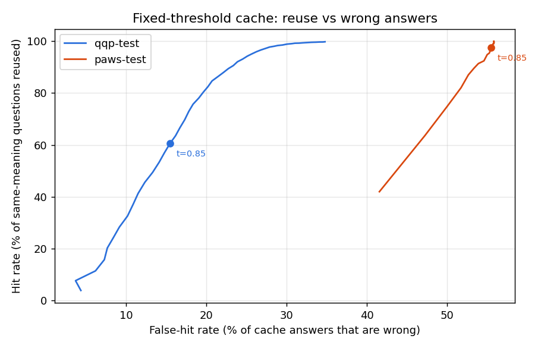

# Phase 1 baseline: fixed-threshold semantic cache

Embedding model `sentence-transformers/all-MiniLM-L6-v2`; baseline threshold **0.85** (the original project's value).

**Hit rate** = share of same-meaning questions answered from cache. **False-hit rate** = share of cache answers that were for a different question.

## Datasets

| Dataset | Pairs | Same-meaning share |
|---|---|---|
| qqp-calibration | 13,590 | 53.0% |
| qqp-test | 14,058 | 54.7% |
| paws-calibration | 7,993 | 44.2% |
| paws-test | 7,987 | 44.2% |

## Pair level at the baseline threshold

| Dataset | AUC | Hit rate | False-hit rate |
|---|---|---|---|
| qqp-test | 0.867 | 60.5% | 15.4% |
| paws-test | 0.630 | 97.6% | 55.5% |

## Hard negatives: share wrongly treated as the same question

| Edit | Pairs | Median similarity | t=0.75 | t=0.8 | t=0.85 | t=0.9 | t=0.95 |
|---|---|---|---|---|---|---|---|
| antonym | 500 | 0.925 | 98.8% | 96.2% | 86.2% | 63.8% | 35.0% |
| entity | 500 | 0.809 | 69.8% | 54.0% | 30.6% | 14.0% | 3.6% |
| negation | 500 | 0.979 | 100.0% | 99.6% | 99.4% | 97.4% | 85.0% |
| number | 500 | 0.952 | 97.8% | 96.8% | 90.8% | 78.8% | 51.6% |

## Best single threshold for an error budget

Chosen on the calibration split (lowest threshold meeting the budget), measured on the test split.

| Budget (max false-hit rate) | QQP threshold | QQP test hit / false-hit | PAWS threshold | PAWS test hit / false-hit |
|---|---|---|---|---|
| 1.0% | 0.998 | 0.7% / 2.0% | not reachable | - |
| 2.0% | 0.996 | 1.1% / 2.4% | not reachable | - |
| 5.0% | 0.963 | 14.0% / 7.4% | not reachable | - |
| 10.0% | 0.917 | 33.9% / 10.4% | 0.999 | 1.4% / 17.7% |

## Workload replay (26,858 queries, QQP test + hard negatives)

Every hit on a hard negative is wrong (it has its own meaning group), so the false-hit rate is also shown for natural QQP queries only.

| Threshold | Hit rate | False-hit rate | False-hit rate, natural only | Wrong answers / all queries | Hard negatives served wrong | Best possible hit rate | Lookup p50 / p99 |
|---|---|---|---|---|---|---|---|
| 0.750 | 42.2% | 53.5% | 45.5% | 22.6% | 1674 / 1998 | 27.2% | 0.19 / 1.00 ms |
| 0.800 | 36.0% | 48.3% | 38.3% | 17.4% | 1573 / 1998 | 27.2% | 0.21 / 1.23 ms |
| 0.850 | 28.9% | 43.5% | 30.9% | 12.6% | 1423 / 1998 | 27.2% | 0.32 / 1.43 ms |
| 0.900 | 20.4% | 40.6% | 23.8% | 8.3% | 1212 / 1998 | 27.2% | 0.40 / 1.88 ms |
| 0.917 | 17.3% | 40.5% | 21.9% | 7.0% | 1108 / 1998 | 27.2% | 0.41 / 1.79 ms |
| 0.950 | 10.9% | 41.2% | 16.9% | 4.5% | 855 / 1998 | 27.2% | 0.51 / 2.51 ms |
| 0.963 | 8.0% | 43.2% | 16.0% | 3.5% | 695 / 1998 | 27.2% | 0.66 / 2.77 ms |
| 0.996 | 0.5% | 27.5% | 11.5% | 0.1% | 25 / 1998 | 27.2% | 0.59 / 2.76 ms |
| 0.998 | 0.3% | 26.2% | 10.1% | 0.1% | 15 / 1998 | 27.2% | 0.65 / 2.62 ms |

Caveat: QQP 'not duplicate' labels are incomplete, so some counted wrong hits may be true paraphrases. False-hit rates here are an upper bound.
