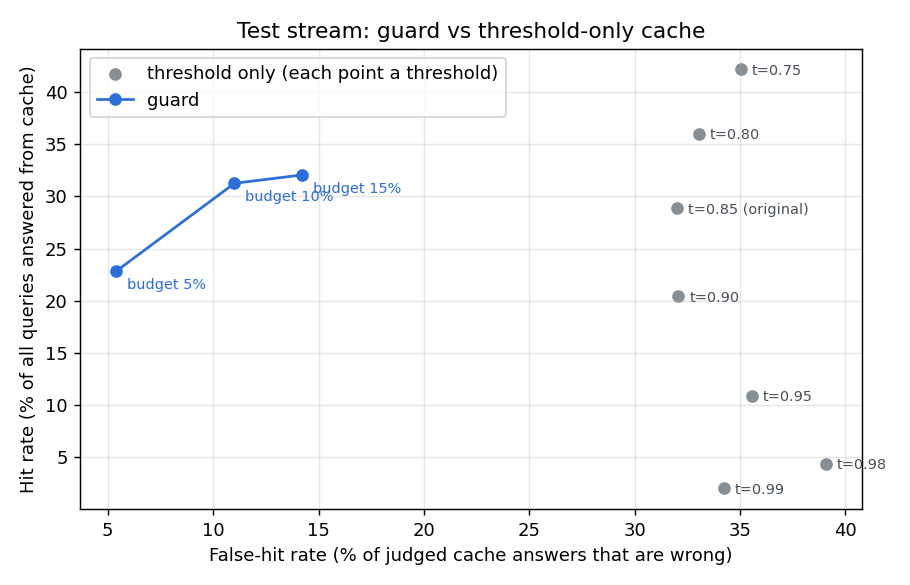

# Phase 3: the guard vs a threshold-only cache

Calibrated on a 26,548-query stream (QQP calibration half + 2,000 hard negatives). Every number below comes from replaying the separate 26,858-query **test** stream, the same stream as the Phase 1 baseline. Verifier: `cross-encoder/quora-distilroberta-base`, 31 ms per pair on this CPU.

**How hits are judged.** QQP annotators labeled specific pairs. A cache hit is *correct* if both questions are in the same labeled duplicate group, *wrong* if the pair was labeled 'not duplicate' or the query is a generated look-alike of the cached question, and *unjudged* otherwise. False-hit rate = wrong / judged hits. (Phase 1 counted every unlabeled pair as wrong; a manual check showed most of those are real paraphrases, so its error rates were inflated.)

Columns: **hit rate** = queries answered from cache; **natural false-hit** = excluding generated hard negatives; **hard negatives wrong** = look-alike questions served the original's answer; **hits judged** = share of hits the labels can judge; **verifier calls** = queries that paid ~31 ms for the cross-encoder.

## Threshold-only cache on the test stream (judged)

| Policy | Hit rate | False-hit rate (judged) | Natural false-hit | Hard negatives wrong | Hits judged | Verifier calls |
|---|---|---|---|---|---|---|
| threshold 0.85 (original) | 28.9% | 32.0% | 14.7% | 1303 / 1998 | 83.0% | 0.0% |
| threshold 0.75 | 42.2% | 35.1% | 21.9% | 1356 / 1998 | 71.6% | 0.0% |
| threshold 0.80 | 36.0% | 33.1% | 18.2% | 1345 / 1998 | 77.2% | 0.0% |
| threshold 0.90 | 20.4% | 32.1% | 10.4% | 1160 / 1998 | 87.4% | 0.0% |
| threshold 0.95 | 10.9% | 35.5% | 6.5% | 832 / 1998 | 91.3% | 0.0% |
| threshold 0.98 | 4.4% | 39.1% | 3.1% | 413 / 1998 | 94.5% | 0.0% |
| threshold 0.99 | 2.0% | 34.2% | 3.7% | 163 / 1998 | 93.8% | 0.0% |

## Error budget 2.0% (settings chosen on calibration data)

| Policy | Hit rate | False-hit rate (judged) | Natural false-hit | Hard negatives wrong | Hits judged | Verifier calls |
|---|---|---|---|---|---|---|

No guard setting met this budget on the calibration stream.

No single threshold met this budget on the calibration stream.

## Error budget 5.0% (settings chosen on calibration data)

| Policy | Hit rate | False-hit rate (judged) | Natural false-hit | Hard negatives wrong | Hits judged | Verifier calls |
|---|---|---|---|---|---|---|
| guard (global) | 22.8% | 5.4% | 3.7% | 74 / 1998 | 73.0% | 61.5% |
| guard (per-cluster) | 23.5% | 5.7% | 3.9% | 82 / 1998 | 72.6% | 62.9% |
| ablation: cross-encoder, no rules | 23.2% | 6.6% | 2.6% | 178 / 1998 | 72.1% | 82.8% |

Global guard setting: gate 0.5, skip verifier above 1.01, min verifier score 0.9, rules on. Per-cluster overrides: 8 of 8 clusters.

No single threshold met this budget on the calibration stream.

## Error budget 10.0% (settings chosen on calibration data)

| Policy | Hit rate | False-hit rate (judged) | Natural false-hit | Hard negatives wrong | Hits judged | Verifier calls |
|---|---|---|---|---|---|---|
| guard (global) | 31.3% | 11.0% | 5.4% | 326 / 1998 | 68.6% | 82.5% |
| guard (per-cluster) | 29.8% | 10.1% | 5.1% | 281 / 1998 | 69.2% | 76.8% |
| ablation: cross-encoder, no rules | 31.3% | 11.0% | 5.4% | 326 / 1998 | 68.6% | 82.5% |

Global guard setting: gate 0.5, skip verifier above 1.01, min verifier score 0.3, rules off. Per-cluster overrides: 8 of 8 clusters.

No single threshold met this budget on the calibration stream.

## Error budget 15.0% (settings chosen on calibration data)

| Policy | Hit rate | False-hit rate (judged) | Natural false-hit | Hard negatives wrong | Hits judged | Verifier calls |
|---|---|---|---|---|---|---|
| guard (global) | 32.1% | 14.2% | 5.5% | 534 / 1998 | 69.5% | 79.2% |
| guard (per-cluster) | 31.7% | 12.8% | 5.6% | 428 / 1998 | 69.1% | 80.0% |
| ablation: cross-encoder, no rules | 32.1% | 14.2% | 5.5% | 534 / 1998 | 69.5% | 79.2% |
| ablation: rules + threshold 0.936, no cross-encoder | 10.3% | 14.7% | 6.2% | 221 / 1998 | 89.2% | 0.0% |

Global guard setting: gate 0.5, skip verifier above 0.98, min verifier score 0.3, rules off. Per-cluster overrides: 8 of 8 clusters.

No single threshold met this budget on the calibration stream.

## Caveats

- Unjudged hits are excluded from the false-hit rate. If unjudged hits were wrong more often than judged ones, true error would be higher; the manual sample suggests the opposite.
- The rules check negation, numbers and names, which is also what the hard-negative generator edits. The 'cross-encoder, no rules' ablation is the non-circular measure on hard negatives.
- The cross-encoder was trained on QQP's train split; this test uses the separate validation split, but it is in-domain. On PAWS (word-order swaps) it scored AUC 0.57, worse than the embeddings' 0.63: word-order paraphrase detection remains unsolved here.

